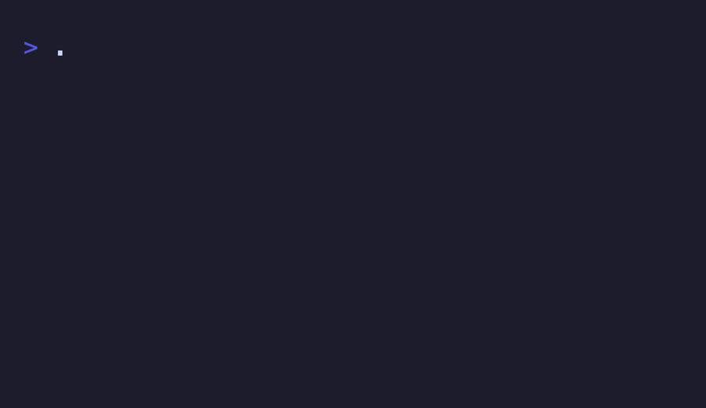

<div align="center">

# my_sokoban

**Le jeu de Sokoban, dans le terminal.**

  

<sub>Projet solo · 2022</sub>

</div>

<br/>

<p align="center"></p>

## En deux mots

Pousser toutes les caisses (`X`) sur leurs emplacements (`O`), au clavier, avec ncurses. Les niveaux sont de simples fichiers texte.

## Ce que ça fait

- Chargement et validation des niveaux depuis un fichier
- Déplacements aux flèches, poussée de caisses, collisions avec les murs
- Détection de la victoire
- Niveaux d'exemple dans [`examples/`](examples)

## Sous le capot

La carte est chargée dans un tableau de chaînes. À chaque touche, on calcule la case visée : si c'est une caisse, on vérifie que la case suivante est libre avant de pousser. 

## Lancer le projet

```bash
make
./my_sokoban examples/level1.txt
```
